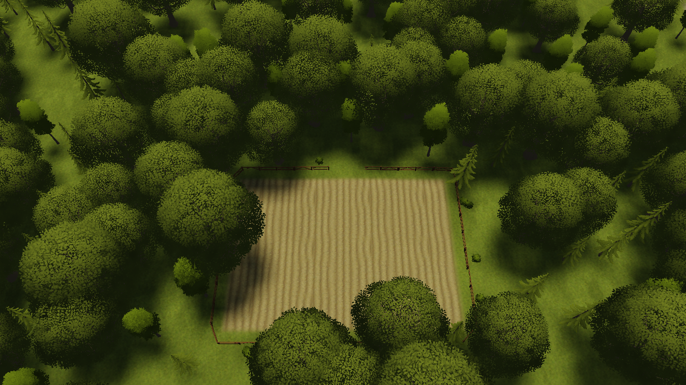

# PCG fields: authoring guide

How to place a fenced farm field with the `Field` control in a Falwyn Forest graph instance, how to cut
a way in, and what to watch for. Background and design decisions:
[the field control design](superpowers/specs/2026-11-12-pcg-field-control-design.md).

## What a field builds

A `Field` is a rectangle control (`Editor/Pcg/Biomes/FalwynForest/Controls/Field.hctl`). Inside a
`FalwynValley` graph instance it builds:

- **Soil** over the whole rectangle (Paint Splat), fading out over `falloff` metres at the edge.
- **The edge section** `FieldEdge.hsec` laid around the rectangle: the fence on the outside, bushes
  beyond it. The section uses the `keepGround` height mode, so the field lies on the terrain as it is.
  Nothing is levelled.
- **No forest inside.** A field is tagged `exclusion` as well as `field`, so the forest scatter leaves
  it out. Only trunks are kept out: the crowns of trees at the edge can still hang over the soil.

| Property | Default | Meaning |
|---|---|---|
| `section` | `Editor/Pcg/Sections/FieldEdge.hsec` | Edge section laid around the field |
| `tileMaterial` | `Models/Terrain/Briarwatch_Farmland_Plowed.hmi` | Tile material that carries the soil layer (see below) |
| `texture` | `Textures/Tilesets/T_Field_Plowed_C.htex` | Terrain layer the field is painted with |
| `falloff` | 1.5 | Distance (m) over which the soil fades out at the edge |

There is no density setting for the fence on purpose. The fence around a field is one connected run,
and a run is kept or dropped as a whole, so anything below 100 % would make whole fences vanish.
Bush density is set in the section's prop rules.

## Placing and shaping a field

1. In the Procedural mode, pick **New Control** and then `Field`. The field is placed at the viewport
   centre as a 20 m x 20 m rectangle.
2. Drag the handle in the middle of a side to move that side. The opposite side stays where it is.
   Drag a corner to move both of its sides. A side can not be dragged closer than 1 m to the one
   opposite it.
3. To move, rotate or scale the field as a whole, use the transform gizmo on it.
4. Rebuild the graph instance.

Every other control (roads, rivers, forest areas, exclusion areas) can be moved, rotated and scaled as a
whole too. Click the diamond at its centre, or **Transform whole control** in the details panel. Click
a point to go back to point editing.

**Furrows are world-aligned.** The soil texture is a terrain layer. On a rotated field the furrows run
at an angle to the fence. Keep fields aligned to the world axes wherever that would show.

## Cutting a gate

A section never places props where an exclusion lies. To open the fence:

- **Exclusion area:** place an `Exclusion` loop over the stretch of fence that should open. Every fence
  piece whose middle lies inside the loop is removed. Bushes inside it are removed too. The other pieces
  stay exactly where they were, so a gate never shifts the rest of the fence.
- **Road:** a road crossing the fence opens it over the road's `clearance` on either side, with no extra
  control.

A gate only removes props. The soil and the section's own paint are not cut. A field never cuts its own
fence or a neighbouring field's fence, even though fields are tagged `exclusion`.

## Tile materials: what to know

A terrain tile (33.3 m) has one material with four paint layers. The default Falwyn tile material has
no soil layer, so a field switches every tile it touches to `tileMaterial`. That material is the same
terrain material with the `T_GrassTerrain_01_01` layer replaced by the soil. Deleting or moving the
field puts the old material back.

Three limits come with that:

1. **The whole tile switches.** Wherever `T_GrassTerrain_01_01` is painted on a switched tile outside
   the field, it now shows soil. The build warns about each tile where that happens. Keep that grass
   layer away from the tiles around a field, or move the field.
2. **One material per tile.** If two fields want different materials on one tile (a Plowed field and a
   Sprouts field side by side), the field stacked later in the graph wins. The other one paints no soil
   on that tile, and the build warns about it.
3. **Two graph instances sharing a tile.** If fields of two different graph instances touch the same
   tile, deleting one of them puts the old material back on that tile under the other field too. Rebuild
   the other instance afterwards.

## Editing the edge section

The edge is an ordinary section world: `Editor/Pcg/Sections/FieldEdge/FieldEdge.hwld`. Local +x points
away from the field: the fence stands at x +1, 1 m outside the rectangle. Open the world, change it and
press **Bake** in the Section panel.

- **The fence is a run.** Its pieces are laid end to end along the field outline at the run's mean x.
  The authored positions only set the order. An L-shaped fence in the corner variant still comes out
  straight. Anything specific to a corner (a post, a gate, a bush cluster) must be a single placement
  with a prop rule, not part of the run.
- **Edge paint** must use layers that exist on both the switched field tiles and the plain Falwyn
  tiles: grass (layer 0), churned dirt (layer 1) or dirt (layer 2). Do not paint with
  `T_GrassTerrain_01_01` (layer 3). That is the slot the farmland material replaces with soil.

## Author's checklist

None of these can be checked unattended. Go through them in the editor:

- [ ] Place a field with the **New Control** menu, then drag its sides and corners.
- [ ] Check that a side handle can still be grabbed when the gizmo covers it on a small rectangle.
- [ ] Check that a handle drag ends when the mouse button is released outside the viewport.
- [ ] Move, rotate and scale a road and a forest area as a whole, using the diamond at the centre.
- [ ] Check that clicking a point still starts point editing.
- [ ] Check that the diamond does not get in the way of a tangent handle lying on it.
- [ ] Paint the edge transition of `FieldEdge` in the Section panel (layers 0 to 2, not layer 3) and
      rebake.
- [ ] Refine `FieldEdge` in the Section panel: bush rules and positions, and fence pieces. Author
      corner-specific props as rules, not as part of the run.
- [ ] Replace the hand-built field in `Worlds/Development` (tiles `30_32` / `30_33`) with a `Field`
      control.
